# BMW iDrive 7 (MGU) — Custom Apps Suite

[English](README.md) · [简体中文 Spotify 指南](README.zh-CN.md)

Build the optional Simplified Chinese Spotify UI with `python3 kit/tools/build.py --language zh-CN spotify` and your own `oap-sdk/`. Chinese translation by 小白151 (JackieZ123430).

<p align="center">
  <b>Custom applications for BMW iDrive 7 (MGU High / Intel Atom A3960), drawn on the head unit's GPU (its renderer composites at 60 fps) and installed through the MGU Store.</b>
</p>

<p align="center">
  
  
  
  
</p>

---

## Credits & Acknowledgements

This repository is built on the open-source BMW iDrive 7 platform:

* [**cauliflowermossgrape/idrive7-apps**](https://github.com/cauliflowermossgrape/idrive7-apps) — the app runtime, the native OpenGL ES renderer, SOME/IP vehicle signals and the TASU UDS diagnostic transport.
  M-Copilot uses that project's Fault Scanner fault-text database (`dtc_db.pack`) and the engine and battery identifier tables of its M Vitals and eDrive apps (MIT License, Copyright (c) 2026 cauliflowermossgrape).
* [**mgu-store**](https://github.com/robertnisipeanu/mgu-store) — the in-car app store, package manager and internet uplink by Robert Nisipeanu.

> [!NOTE]
> For SDK extraction, toolchain documentation, SOME/IP signal catalogs and renderer internals, see [**cauliflowermossgrape/idrive7-apps**](https://github.com/cauliflowermossgrape/idrive7-apps).

---

## Included Applications

| App | Version | Needs internet | Touches vehicle ECUs |
| :--- | :---: | :---: | :--- |
| [Spotify](#1-spotify-spotify) | 1.0.23 | Yes | No |
| [M-Copilot](#2-m-copilot-m_copilot) | 1.0.20 | Yes | No (reads driving signals, service list and fault memory) |

> [!NOTE]
> **M-Cinema (YouTube player) has been removed**: playback was unreliable on some firmware and the sound was poor, and CarPlay and Android Auto workarounds play YouTube better.

### 1. Spotify (`spotify`)
**Spotify Connect controller and library browser on the iDrive 7 central display.**

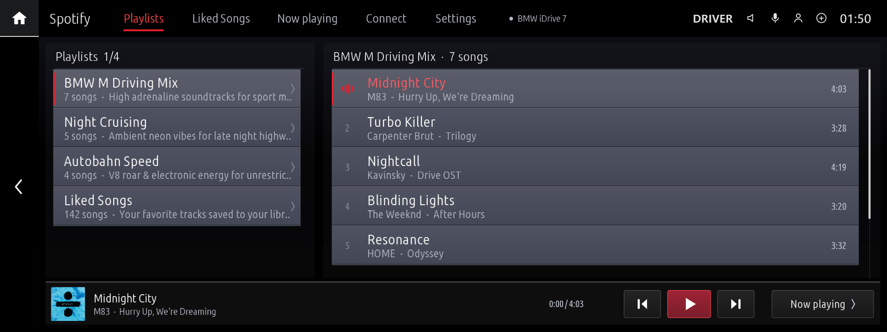

* **Pair from your phone**: the Connect tab shows a QR code for [`pair.html`](https://hexlay.github.io/idrive7-custom-apps/pair.html). Sign in to Spotify on your phone (cellular data or Wi-Fi) and the login reaches the car end-to-end encrypted (see [Privacy & Security](#privacy--security)). Switching account is a disconnect and a new pairing, both from the phone.
* **Library & playback**: all your playlists and liked songs (more load as you scroll; the library shows at once when the app opens, from a copy kept on the car, and refreshes in the background), Liked Songs played as Spotify's own collection, now playing with tap-to-seek, shuffle, repeat and like, Up Next you can jump into, and switching between Spotify Connect devices. Buttons that wait for Spotify show a spinner until it answers. Georgian titles and artists are shown in Georgian script. When something fails (no device to play on, Premium needed, no connection) a short message says why; with no active device, playback starts on the phone that played last.
* **Internet through the MGU Store uplink**: looks up names through the uplink's DNS (see [Internet access](#internet-access)) and checks connectivity with a real HTTPS request. Without internet the player locks with **NO INTERNET CONNECTION**, **Retry** and **Switch to Demo Mode**.
* **Sized for your display**: rows, buttons and text are sized in millimetres on the glass, as CarPlay sizes its own, so they are as easy to read and press on a 10.25" display as on a 12.3" one (the 12.3" display shows more rows instead). A tap just beside a button still presses it, and no text is drawn too small to read. The display is found on its own.
* **Settings tab**: colour theme (Spotify Green, M Tricolour, M Red, Ice White, Night Amber), playback mode (Online, or Demo with sample music and no account), screen size (Automatic, 10.25", 12.3", 8.8"), screen layout (full screen or standard), renderer (GPU, or software) and how often playback is synced with Spotify (1 to 10 s, every 2 s by default).
* **Light on the head unit**: up to 30 frames a second while music plays and 10 when paused, and a paused screen that doesn't change isn't drawn again (about once a second instead).
* **Foreground only**: nothing runs while Spotify is off screen. A disconnect sent from the phone meanwhile is applied when you come back to it, or at the next start within 12 hours. The pairing survives restarts.

| Now Playing | Liked Songs |
| :---: | :---: |
| 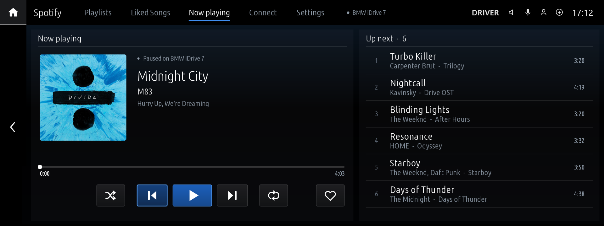 | 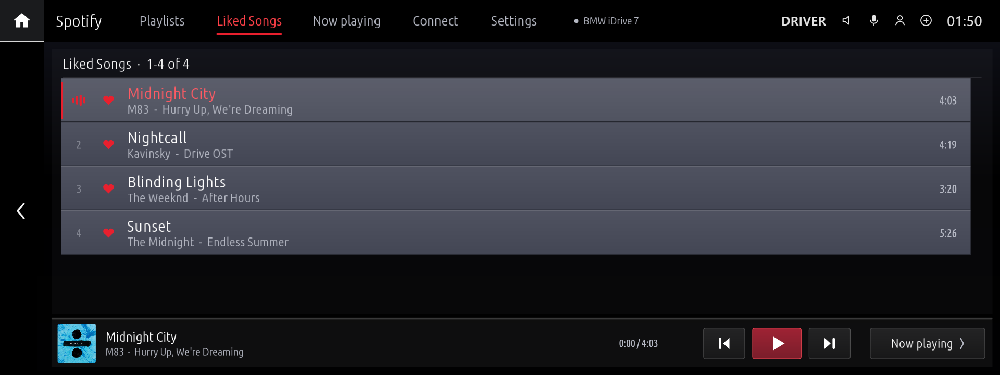 |
| **Phone QR Pairing & Devices** | **No Internet** |
| 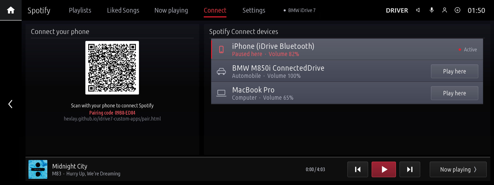 | 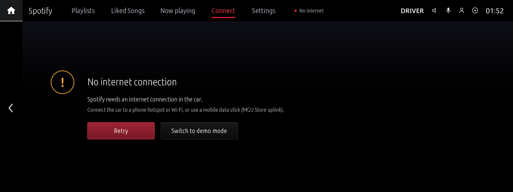 |
| **Settings** | |
| 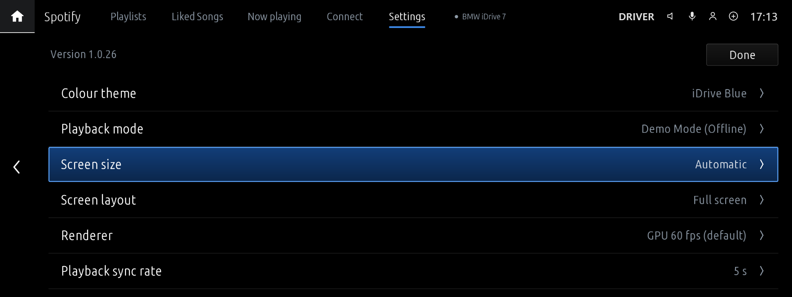 | |

---

### 2. M-Copilot (`m_copilot`)
**AI co-driver and assistant for BMW G-Series vehicles.**

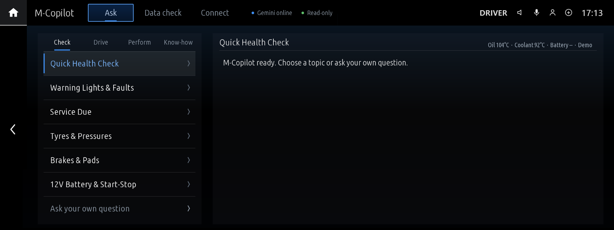

* **Ask about your car**: 24 topics in four groups (**Check**, **Drive**, **Perform**, **Know-how**), from a health check and service due to launch, heat soak and known weak points, worded for a stock daily car as well as a tuned one. Or type your own question with the on-screen keyboard. Under each answer, one-tap follow-ups (*What should I do?*, *Safe to keep driving?*, *Explain more*) go on in the same conversation.
* **Knows which car it is in**: make and model year from the VIN (MainApp hands it to every app it starts), the engine type, and the engine and gearbox control unit types, which name the engine family and gearbox (read once per car and kept). The serial part of the VIN never leaves the car.
* **Your car profile (optional)**: on the phone page, add the model, tune stage, power, modifications, tyres, fuel and how you use the car. It is sent end-to-end encrypted like the key and can be changed at any time without re-pairing. A tuned car gets advice for its higher load.
* **Answers from your car's real data**: speed, rpm, gear, torque, boost, driving mode, engine state, auto start-stop, parking brake, oil and coolant temperature, oil level, outside temperature, tyre pressures and temperatures against the car's own targets, fuel, range, trip average, odometer, 12 V battery charge, the M xDrive setting on M models, and the cluster's own service list (oil, brakes, brake fluid, inspections, with distance and date). A value the car hasn't sent is named as unavailable: M-Copilot never fills in a number.
* **Remembers the drive**: while M-Copilot is on screen it keeps a few running figures of the drive: top speed and rpm, oil and coolant range, revving with cold oil, time at high rpm, peak g, the hottest tyre, and from light engine-computer samples under load, intake air heat, boost falling short of its target and the lowest ignition timing. "How was that drive?" and the tune and heat questions use them.
* **Short when moving, full when parked**: while the car is moving, answers are three short lines in larger text, to glance at; standing, up to eight lines.
* **Your units and language**: numbers come in the car's own units (psi or bar, °F or °C, miles or km, as set in the iDrive), and answers in the language picked on the phone page: English, Georgian, or German, French, Spanish, Italian, Dutch, Portuguese, Turkish or Polish (shown without accents; the car's fonts draw Latin and Georgian). Add the country you drive in, and answers follow its fuels, inspections, tyre rules and climate.
* **A look into the engine computer**: with each question, a quick read-only snapshot of what M Vitals shows live: boost actual vs target, intake air temperature, air charge (load) actual vs target, ignition timing, high- and low-pressure fuel, misfires per cylinder, gearbox oil temperature and 12 V voltage; on plug-in hybrids also the high-voltage battery's charge and health. It runs only while the car is steady, within a few seconds, and is kept for 20 s.
* **Warning messages and fault memory**: the Check Control messages active in the cluster are always part of the context. The health check and faults topics (or any question about faults) also read the stored faults of every control unit, with BMW's own fault descriptions (the Fault Scanner's fault-text database), so the AI explains the actual faults instead of hex codes. Each fault says whether it is **active now**, happened during this drive or is an older stored one, and whether it asked for the warning lamp, so the answer leads with what matters now.
* **Pair from your phone**: M-Copilot opens on its Connect tab with a QR code. Scan it and enter the provider and API key on [`copilot.html`](https://hexlay.github.io/idrive7-custom-apps/copilot.html); the key reaches the car end-to-end encrypted, as with Spotify. Once paired, the tab shows the connection (provider, model, internet) and what the phone set (car profile, AI model), with a QR code to open the phone page.
* **Disconnect from the phone only** (the car's page or *My cars*): the car drops the AI key and what the phone set and shows a new QR code. A new AI key is also set from the phone. Spotify works the same way.
* **Data check page**: a second tab lists what this car actually gives, source by source: the VIN (type part) and where it came from, engine and gearbox units, every live signal with its value or why there is none (waiting, not on this car's firmware, error), the diagnostic link, the last fault read, and every engine-computer value with the identifier that answered it. *Read engine now* and *Read faults now* read on demand, under the same safety rules.
* **Safe with the engine on or off**: driving data are passive subscriptions. Diagnostic reads (fault memory, and the one-time identification) are read-only requests in the default session, made only when a question needs them, and never while the engine is starting or the car is switching off; M-Copilot waits for a steady state instead. What is read follows the car's state: parked without ignition (units asleep) a fault read is marked as possibly incomplete and the engine computer is left alone; with the engine off, boost, load, timing and misfires are not read, and voltages, oil level and temperatures are labelled for what they then mean.
* **Your choice of AI provider and model**: Google Gemini, Anthropic Claude (Claude Haiku 5.5 by default), OpenAI, Groq or OpenRouter, and the model on the phone page (e.g. Flash-Lite first, Claude Sonnet 5.5). The status bar shows the model that answered; when Gemini Flash is overloaded, Flash-Lite answers instead. Connections are reused, so an answer doesn't wait for a new TLS handshake.
* **Sized for your display**, as in Spotify: topics, keys, chips and answers.
* **Foreground only**: driving signals, warning lights, the service list, pairing checks and the internet check run only while M-Copilot is on screen; once you leave it nothing is subscribed, drawn or polled. What the phone sends meanwhile (a disconnect, a new key, profile or model) is picked up the next time the app is opened, within 12 hours: the relay keeps it that long, and the car is never woken for it. Until the car has a new key, the phone page says it is waiting for the car. The API key is stored once, in the app's data folder (readable by the app only).

| Ask Your Own Question | Data Check |
| :---: | :---: |
| 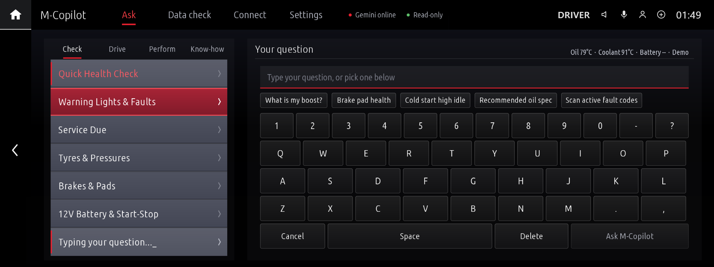 | 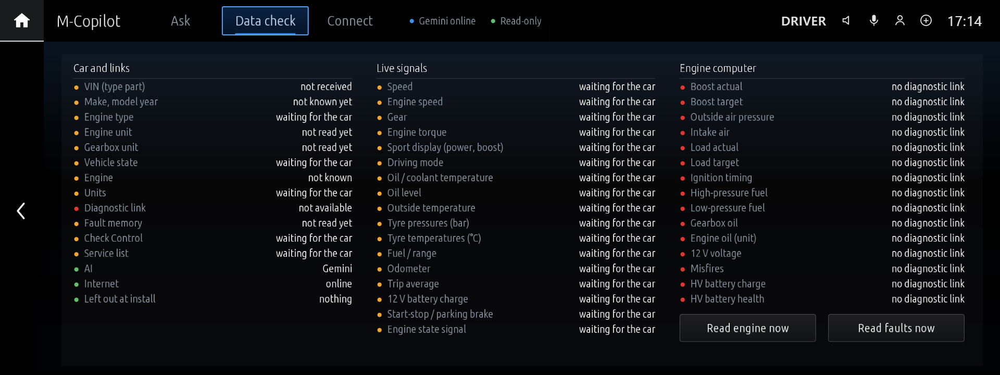 |
| **Phone QR Pairing** | **Connected** |
| 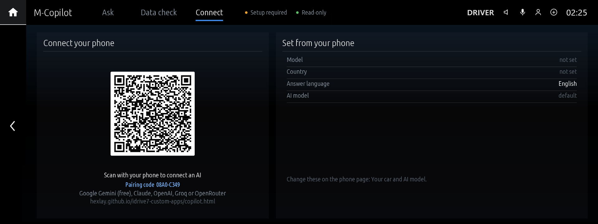 | 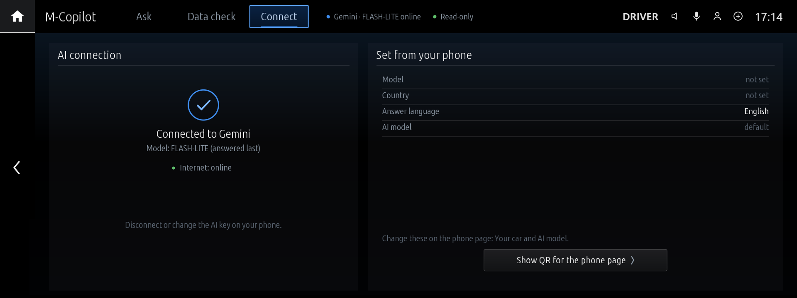 |

---

## How to Install via MGU Store

The recommended way to install and update these apps is the [**MGU Store**](https://github.com/robertnisipeanu/mgu-store):

1. On the central display, open **MGU Store > Sources > Add source**.
2. Enter this repository:
   ```text
   hexlay/idrive7-custom-apps
   ```
3. Tap **OK**. The MGU Store reads `mgu-repo.json` and lists the two apps. They need the GPU renderer (`idrive7-renderd`) and the controller gate (`mgu-inputgate`), which the store doesn't install from this repository: add [cauliflowermossgrape/idrive7-apps](https://github.com/cauliflowermossgrape/idrive7-apps) as a source too and install them from there (most cars with these apps have them already). `kit/renderd` here is a copy of their source, used by the browser emulator and the SSH deploy kit.
4. Tap an app to install it. Updates appear in the store when a new version is pushed.

### Older firmware (e.g. MainApp 6.5.5)

The head unit's installer refuses an app outright if its SOME/IP manifest names an interface, field or method the firmware's catalog (`/etc/oap/someip/someip-interfaces.json`) doesn't have, and older firmware has fewer. The MGU Store builds these apps on the head unit, and the build fits each app's vehicle signals to that unit's catalog: what the unit lacks is left out, so the app installs and runs without those values. The app's log lists them at start (`this unit has no ... - running without it`).

### The phone app

The phone pages ([My cars](https://hexlay.github.io/idrive7-custom-apps/), M-Copilot's and Spotify's) install as an app, **iDrive Apps**, for all your cars one tap from the Home Screen:
* **iPhone**: in Safari, tap **Share**, then **Add to Home Screen**. Open **iDrive Apps** from the Home Screen and add your cars with its **Scan car QR**: on iPhone the Home Screen app keeps its own cars, apart from Safari's (a car QR code scanned with the camera opens in Safari).
* **Android**: in Chrome, tap **Install app** on My cars (or the **⋮** menu, then **Install app** / **Add to Home screen**). The app shares Chrome's cars.

A phone that no longer has a car (a new phone, a cleared browser, another browser) gets it back by scanning *Show QR for the phone page* on the app's Connect tab, and can then disconnect it. The page shows the car's own settings (provider, model, car profile, never the key).

### Internet access

Spotify and M-Copilot need the MGU Store's **internet uplink** (`mgu-uplink`): Wi-Fi such as a phone hotspot, a USB-tethered phone, an LTE stick or a USB Ethernet adapter. The store routes only apps that declare `"mguInternet": true`, and the head unit's own resolver cannot reach the internet, so these apps resolve names through the DNS servers of the uplink's lease (`kit/runtime/uplink.js`).

The phone link uses the public relay `ntfy.sh`, which limits requests per internet address. The apps read their pairing channel through one long-lived connection (`kit/runtime/relay_stream.js`) instead of polling it, so a car, an emulator and the phone sharing one connection don't use up the limit; the phone pages send with plain requests (no CORS preflight) and try again when the relay is briefly unreachable.

If an app says it is offline while the store shows **Online**, look for the `uplink:` line at the start of the app's log (`<app>.log` in its data folder):
* `lease <ip> via <interface>` — the app is routed; the problem is elsewhere.
* `no lease ... uplink is online but this app is not routed` — reinstall the app from the store so it is added to the uplink's app list.
* `no lease ... uplink offline or not installed` — connect the store to a network first.

---

## Platform & Developer Documentation

For everything else, including:
* **SDK extraction & setup** (`kit/tools/extract_sdk.js`)
* **Vehicle SOME/IP signal catalogs**
* **The native C / Wayland / OpenGL ES GPU renderer** (`mgu-render`)
* **Controller input hooks** (`mgu-inputgate`)
* **OBD-ENET / SSH deployment scripts**
* **Creating new apps**

👉 **See the source repository: [cauliflowermossgrape/idrive7-apps](https://github.com/cauliflowermossgrape/idrive7-apps)** and the [**MGU Store guide**](https://github.com/robertnisipeanu/mgu-store).

To build locally: `python3 kit/tools/build.py <app_id>` writes `dist/<app_id>@<version>.mgu` and `.tgz` (it needs `oap-sdk`, extracted from your own head unit with `kit/tools/extract_sdk.js`). `node kit/tools/emu.js <app_id>` runs an app in the browser emulator, and `node kit/tools/preview.js dist/<app_id> <outDir>` renders it to PNGs.

---

## Privacy & Security

* **No hardcoded secrets**: this repository contains no API keys, client secrets, tokens or personal identifiers.
* **End-to-end encrypted pairing**: Spotify tokens and AI provider keys travel from the phone to the car through a public relay (`ntfy.sh`), encrypted with AES-256-GCM using a key that only exists in the car's QR code (in the link's `#k=` fragment, which browsers never send to a server). The car accepts only messages that decrypt and authenticate with that key. What the car tells the phone (paired, its settings) is encrypted too, with a second key derived from it (HKDF-SHA256), so neither side can be fooled by its own messages. Every message carries its send time and a nonce inside the encryption: a message re-posted to the channel later, or a repeat, is dropped ([`kit/runtime/link_crypto.js`](kit/runtime/link_crypto.js)).
* **Keys on the phone**: the pages read the key from the QR link, remove it from the address bar at once, and keep it as a **non-extractable** WebCrypto key in the browser's IndexedDB: the pages can use it, but no script can read the key back out. [`docs/index.html`](https://hexlay.github.io/idrive7-custom-apps/) lists the cars a phone has (**My cars**) and scans QR codes in the page; only this site's own pairing links are accepted. The 8-character code shown on the car only finds a car the phone already has, so a code seen on the screen is no use to anyone else.
* **Hardened pages**: a Content Security Policy limits where the pages may connect (`ntfy.sh`, and Spotify's token endpoint on the Spotify page) and load code from (this site only; the QR decoder is vendored in [`docs/vendor`](docs/vendor), not loaded from a CDN), no referrer is sent, and the pages refuse to run inside another site's frame. The Spotify login uses PKCE with a random verifier and a random `state` checked on return, so a login the page didn't start is never sent to a car.
* **Verified TLS**: all requests that carry tokens or keys verify the server's certificate chain and hostname; only the head unit's possibly wrong clock is tolerated.
* **Local data**: tokens (`spotify_auth.json`, `copilot_auth.json`) and app state stay in each app's data folder on the head unit, one copy each (readable by the app only); a copy an older version kept next to the app's code is moved there.
* **Git protection**: auth, state and key files (`*_auth.json`, `*_state.json`, `*.key`, `*.pem`) are excluded in `.gitignore`, and the build never packages them.
* **Tested**: `node kit/tools/test_carlink.js` runs the page library against the car modules (tampering, replays, foreign links, the relay's limits); `node kit/tools/test_spotify.js` runs Spotify's client against a fake Web API, `test_spotify_auth.js` checks where it keeps the login, and `kit/tools/test_zh.js` / `test_zh.py` check the language builds.

---

## License

This project is released under the GNU General Public License v3.0 or later ([`LICENSE`](LICENSE)).
It is built on [cauliflowermossgrape/idrive7-apps](https://github.com/cauliflowermossgrape/idrive7-apps), released under the MIT License: its copyright and permission notice are kept in [`LICENSE.MIT`](LICENSE.MIT), and every app package carries both files. The renderer source in `kit/renderd` keeps its own licence files.
Not affiliated with or endorsed by Bayerische Motoren Werke (BMW) AG.
